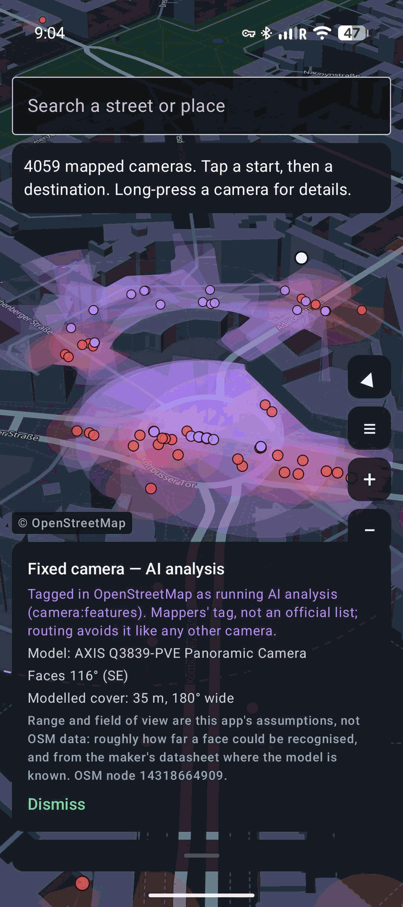
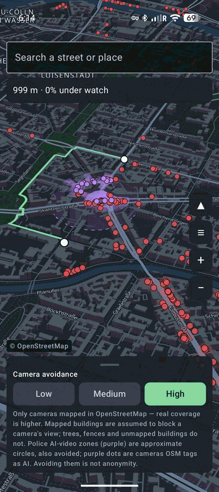
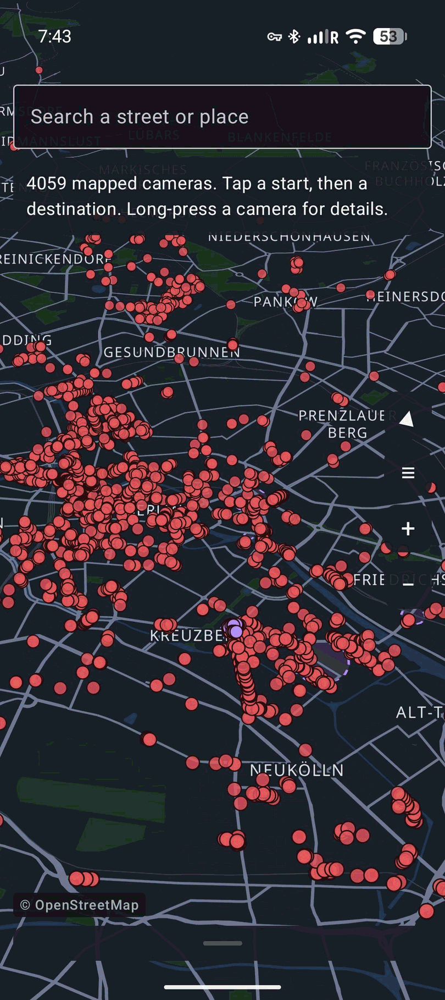

# SchattenWeg

<p align="center">
  <a href="https://github.com/phrag/SchattenWeg/actions/workflows/ci.yml"></a>
  <a href="https://github.com/phrag/SchattenWeg/actions/workflows/release.yml"></a>
  <a href="https://github.com/phrag/SchattenWeg/releases/latest"></a>
  <a href="LICENSE"></a>
  
  
  
  
</p>

<p align="center">
  
  
  
</p>

A private, secure, offline Android app that maps Berlin's CCTV cameras and plans walking routes that **avoid** them.
Free and Open Source!

<p align="center">
  <a href="https://github.com/phrag/SchattenWeg/releases/latest/download/schattenweg.apk"></a>
</p>
<p align="center">
  Latest Stable version &middot; 112 MB &middot; Android 10 or newer &middot; free, no account
</p>

### Install in 3 steps

1. **Tap the green button** above on your phone. If your browser says the file
   "may be harmful", tap **Download anyway**. Every app from outside a store
   gets that warning.
2. **Open the downloaded file.** If Android says it can't install from this
   source, tap **Settings**, switch on **Allow from this source**, then go back.
3. **Tap Install**, then **Open**. If *Play Protect* warns you, tap
   **More details → Install anyway**.

That's it. Nothing to set up. Works on GrapheneOS too.

> The file is large because the whole Berlin map is inside, so Wi-Fi is best.

### Update

Download the newest version the same way and tap **Install**. It replaces the
old one and keeps working. **☰ → About** in the app shows which version you
have. To get an email for new versions, use **Watch → Custom → Releases** on
GitHub.

<details>
<summary><b>Other versions, and checking the file is genuine</b></summary>

<p align="center">
  <a href="https://grapheneos.org"></a>
</p>

| Channel | Download | Version | Built | Cameras | Details |
|---|---|---|---|---|---|
| **Stable** (recommended) | **[⬇ schattenweg.apk](https://github.com/phrag/SchattenWeg/releases/latest/download/schattenweg.apk)** |  |  |  | [Release notes](https://github.com/phrag/SchattenWeg/releases/latest) |
| **Nightly** | **[⬇ schattenweg-latest.apk](https://github.com/phrag/SchattenWeg/releases/download/latest/schattenweg-latest.apk)** |  |  |  | [Build info](https://github.com/phrag/SchattenWeg/releases/tag/latest) |

<sub><b>Stable</b>: tested versions, recommended &middot; <b>Nightly</b>: rebuilt every night with cameras pulled live from OpenStreetMap &middot; <a href="https://github.com/phrag/SchattenWeg/releases">all releases</a></sub>

**Stable or Nightly?** Stable is the tested version; pick it unless you want
the newest cameras sooner. Both use the same signing key, so you can switch freely.

**Check the file is genuine:** run `apksigner verify --print-certs
schattenweg.apk` and compare the SHA-256 with the fingerprint in
[SECURITY.md](SECURITY.md#signing-keys--never-in-this-repository).

</details>

---

## Contents

- [Download &amp; install](#download--install) — get it on your phone
- [What it does](#what-it-does)
- [How to use it](#how-to-use-it) — a quick walkthrough
- [Your privacy](#your-privacy)
- [Honesty about the limits](#honesty-about-the-limits)
- [Where the AI-camera facts come from](#where-the-ai-camera-facts-come-from) — sources
- [Build from source](#build-from-source) — for developers
- [Contributing](#contributing)
- [Report a problem](#report-a-problem)
- [Credits](#credits) &middot; [Licence](#licence)

---

## Download & install

The quick steps are [at the top of this page](#install-in-3-steps). The details:

- **Stable** is a numbered version (e.g. 0.2.4), cut when features are
  finished. Its camera data is fresh from OpenStreetMap on the day it was
  released.
- **Nightly** is whatever is on `main`, rebuilt **every night**. Its cameras
  are **pulled live from OpenStreetMap** (one Overpass query at build time), so
  they are minutes old rather than a day behind; roads and buildings still come
  from the daily Geofabrik extract. If Overpass is unreachable the build falls
  back to the extract's own cameras. The app's **About** section (☰) links to
  the Nightly download.
- Both are signed with the same release key, so you can switch between them
  and keep updating over the top. Android won't install an older version over a
  newer one; to go back, uninstall first.

On a computer instead? Download the same file and copy it to your phone.
Older versions are on the
[Releases page](https://github.com/phrag/SchattenWeg/releases), and the file is
also under **Assets** on each release.

> **Want to check it's genuine?** The certificate fingerprint is in
> [SECURITY.md](SECURITY.md). You can also [build from source](#build-from-source).

Right now the data covers **Berlin only**.

---

## What it does

- **Shows the cameras.** Every `man_made=surveillance` camera OpenStreetMap
  knows about in Berlin, drawn on an offline map with its modelled field of
  view. Long-press one to see its details.
- **Routes around them.** Pick a start and a destination and SchattenWeg finds a
  walking route that stays out of camera view where it reasonably can. A simple
  **Low / Medium / High** control sets how much extra walking you'll accept to
  dodge a lens. Every new route starts on **High**, so when a camera-free route
  exists you get it by default; lower the setting if you'd rather walk less.
- **Marks Berlin police AI-video zones.** Sites where the police run or have
  announced AI behaviour detection on CCTV (Kottbusser Tor, Warschauer Brücke,
  Alexanderplatz, Görlitzer Park and more) are drawn as violet dashed circles
  and treated as watched ground when routing. No official boundaries are
  published, so the circles are approximate. Long-press one for its status and
  what it detects. Every fact on those cards is
  [sourced below](#where-the-ai-camera-facts-come-from).
- **Shows AI cameras mapped by OpenStreetMap contributors.** Volunteers have
  started mapping individual AI cameras: the police's AI cameras at
  Kottbusser Tor are now in OpenStreetMap, along with the cameras tagged for
  face detection at Südkreuz station (the federal police's face-recognition
  trial there ran from August 2017 to July 2018; the tag records that trial,
  not a current one). The app draws them as **violet dots**, and
  long-pressing one says it is tagged as AI. Routes avoid them like every other
  camera. As more get mapped, the nightly build picks them up.
- **Finds places offline.** Search streets, neighbourhoods and stations from a
  bundled index — so even typing a destination reveals nothing to anyone. Toggle
  map layers and zoom, all offline too.
- **Everything above happens on your phone**, with no connection.

---

## How to use it

Once it's installed, there's nothing to set up — open it and go:

1. **See the cameras.** The map opens on Berlin. Red dots are cameras; the
   faint red shape around each one is the area it's modelled to watch — a wedge
   for a fixed camera with a known direction, a circle for a dome, a panning
   camera or one whose direction is unknown. Mapped buildings cut the shape
   short, since a camera can't see through a wall. Violet dashed circles are police
   AI-video zones. Pinch to zoom and drag to pan. **Long-press a camera** (or a
   violet zone) for its details.
2. **Pick where you're going.** Use the **search box** at the top to find a
   street, neighbourhood or station, or just **tap the map** to drop a start
   point and then a destination (white dots). **Long-press empty map** to undo
   the last point.
3. **Get a quieter route.** SchattenWeg draws a walking route that stays out of
   camera view where it reasonably can. If a camera-free route exists, it picks
   that one for you automatically. The route is drawn in green, with its length
   and the share of it that is under watch shown at the top.
4. **Trade detour for privacy.** The **Low / Medium / High** control decides how
   much extra walking you'll accept to avoid a lens. *Low* keeps it short;
   *High* takes bigger detours to stay hidden. Change it and the route redraws.
5. **Tidy the view.** The layers button (**☰**) lets you turn cameras, camera coverage,
   AI camera coverage, AI-monitored zones, labels and buildings & landuse on or off, and holds the
   app's credits, version, licences and links. Hiding a layer doesn't change
   how routes are planned. **3D buildings** is on by default, so the map opens
   tilted with the buildings standing up (drag two fingers to tilt it yourself).
   Switch it off to level the map back out. It is only a view; it doesn't change
   what blocks a camera's view.

---

## Your privacy

This is the whole point of the app, so it's worth being explicit.

- **No internet permission at all.** The app doesn't declare `INTERNET`. It
  *can't* phone home, send analytics, or fetch a map tile mid-route, because
  Android won't let it open a socket. A surveillance-avoidance tool that quietly
  talked to a server would defeat its own purpose.
- **Fully offline.** The Berlin map, camera data, place-search index and the
  routing engine are all bundled in the app and run locally.
- **Your location stays on the device.** The app holds no location permission
  at all (there's no "centre on me" yet — you pick start and destination on the
  map). If positioning is ever added it will use the platform's own GPS
  (`LocationManager`), never Google's Fused Location Provider, which routes
  through Google's servers.
- **No Google, no Firebase, no analytics, no ad SDKs.** The map is drawn with
  MapLibre from bundled vector tiles, not the Google Maps SDK, so no tile server
  ever sees where you're looking. (The MapLibre library was audited: no
  telemetry classes, and its bundled `INTERNET`/Wi‑Fi/location permissions are
  stripped out during the build.)
- **Nothing is backed up off-device.** Android cloud backup is disabled for the
  app.

The full threat model — including what this app deliberately does **not**
protect against — is in **[SECURITY.md](SECURITY.md)**.

---

## Honesty about the limits

- The map shows only cameras **mapped in OpenStreetMap**. Real-world coverage is
  higher — treat an empty street as "unknown", not "unwatched".
- Only **mapped buildings** are assumed to block a camera's view (and only ones
  tall enough to, roughly two storeys up). Trees, fences, vehicles and
  unmapped buildings aren't modelled, so a street that looks hidden behind a
  building may still be watched.
- The AI-video zones are **approximate circles**, not surveyed outlines: the
  Berlin Senate has not published boundaries or camera positions. Some sites
  are only planned, and routes treat all of them as watched. The violet AI
  camera dots are what OSM contributors have mapped and tagged, not an
  official list.
- Each camera's **range and field of view are assumptions**, not OSM data or
  measurements. By default a camera covers 20–30 m (by type) and a fixed one
  with a mapped direction a 60° cone; read that as roughly how far a face could
  be recognised, not how far the camera can see. A camera with no mapped
  direction is treated as covering all round. For two models, the AXIS
  Q3839-PVE (180° panorama, 35 m) and Q1809-LE (90°, 60 m), the figures are
  taken from Axis's published datasheets and are still estimates.
- Avoiding mapped cameras **reduces exposure; it is not anonymity.** A route that
  conspicuously weaves around every lens can itself draw attention.

All of these are shown inside the app, on purpose.

---

## Where the AI-camera facts come from

The AI-video zone cards and the AI-camera dots rest on public sources, not
guesswork. Each claim below was last checked on **29 October 2026**. The zone
table itself lives in [`core/src/zones.rs`](core/src/zones.rs); update it and
this list together.

| Claim | Status | Source |
|-------|--------|--------|
| Police AI video ("KI-gestützter Videoschutz") starts at Kottbusser Tor; configuration of the cameras began 24 Sep 2026, takes about four weeks, then a test phase follows; the FAQ's status graphic now reads "Phase 3 Testphase umgesetzt" (28 Oct 2026) | Confirmed | [Polizei Berlin press release No. 1252, 24 Sep 2026](https://www.berlin.de/polizei/polizeimeldungen/2026/pressemitteilung.1718008.php); [FAQ](https://www.berlin.de/polizei/polizeimeldungen/fakten-hintergruende/artikel.1694896.php) |
| Not issuing alerts yet: during configuration and testing the system detects and reports nothing, and is not yet running 24/7 | Confirmed | [Polizei Berlin FAQ on KI-gestützter Videoschutz](https://www.berlin.de/polizei/polizeimeldungen/fakten-hintergruende/artikel.1694896.php) |
| Software has been evaluating people's behaviour at Kottbusser Tor since 6 Oct 2026 | Press claim (commentary), unconfirmed; the police FAQ says nothing is detected or reported during the test phase | [netzpolitik.org, 23 Oct 2026](https://netzpolitik.org/2026/koalitionsverhandlungen-in-berlin-rot-rot-gruen-muss-ki-kameras-stoppen/) |
| About 30 cameras at Kottbusser Tor | Confirmed (police figure via press; nd, 28 Oct, also says 30) | [netzpolitik.org, 23 Aug 2026](https://netzpolitik.org/2026/verhaltensscanner-in-berlin-jetzt-beginnt-die-automatisierte-ueberwachung/), quoting Polizei Berlin; the police's own pages give no number |
| All 30 are mapped in OpenStreetMap (`camera:features=artificial intelligence`, `operator=Polizei Berlin`) | Confirmed (counted in the OSM API) | [OpenStreetMap, Kottbusser Tor](https://www.openstreetmap.org/#map=19/52.4990/13.4178) |
| Warschauer Brücke: planned by the end of 2026, no firm date | Confirmed | [Senate answer, Drucksache 19/26970, 6 Sep 2026](https://pardok.parlament-berlin.de/starweb/adis/citat/VT/19/SchrAnfr/S19-26970.pdf), answer to Q1 |
| Alexanderplatz and Görlitzer Park: planned for 2027 | Confirmed | Drucksache 19/26970, answer to Q2; order Warschauer Brücke → Alexanderplatz → Görlitzer Park/Wrangelkiez in the press release |
| Görlitzer Park: the busy entrances, the crossings between Reichenberger Kiez and Wrangelkiez, and the fence line, not the whole park | Confirmed (press, from the tender) | [taz, 9 Mar 2026](https://taz.de/KI-Videoueberwachung-in-Berlin/!6160851/) |
| Detects violence (people hitting or kicking) and emergencies (people lying motionless) | Confirmed | Drucksache 19/26970, answer to Q6 |
| Black screen until the software flags an event; an officer then decides | Confirmed | Press release No. 1252; Drucksache 19/26970, answer to Q6 |
| Police say faces are not analysed and live biometric identification is not allowed under the ASOG Bln | Police claim, unverified | [Polizei Berlin FAQ](https://www.berlin.de/polizei/polizeimeldungen/fakten-hintergruende/artikel.1694896.php). No independent audit is public, and the Senate declined technical detail (Drucksache 19/26970, answer 1d) |
| The software vendor advertises "cross-camera, non-biometric tracking" of people; how people are matched between cameras is not stated | Vendor marketing, unverified | [Staige](https://staige.com/en) |
| The software works on a stick-figure model, but an alert makes the Kottiwache screen beep and show the unpixelated video, and the officer decides on a response; it targets hitting, kicking and people lying on the ground. Footage is kept up to 28 days (longer if evidence, and then the BKA face-recognition software may be used). The police say the cameras must be switched off during assemblies, shown by their red lights going out. Spranger had said officers would see only "stick figures" and admitted on 28 Oct that this was wrong | Confirmed (press reports of the 28 Oct demonstration; nd gives 28 days, taz "one month") | [nd, 28 Oct 2026](https://www.nd-aktuell.de/artikel/1203508.ueberwachung-ki-am-kotti-kamera-laeuft.html); [taz, 28 Oct 2026](https://taz.de/KI-Videoueberwachung-in-Kreuzberg/!6225655/) |
| Signs at every entrance to a covered area | Confirmed (promised) | Drucksache 19/26970, answer to Q1b |
| No boundaries or camera positions published | Confirmed | Neither the press release nor the FAQ gives them, and the Senate declined further technical detail on security grounds (Drucksache 19/26970, answer to Q1d) |
| Building-protection pilots at the Rotes Rathaus, the Altes Stadthaus and the Jüdisches Museum: test phase Q2 2027, live trial Q3–Q4 2027 | Confirmed | Drucksache 19/26970, answer to Q4 |
| What the building pilots detect: entering closed areas, crossing virtual lines, climbing fences or walls, vandalism and abandoned objects | Confirmed | Drucksache 19/26970, answer to Q6 |
| Cameras at Südkreuz station tagged `camera:features=facedetection` | Confirmed, but historical | [OpenStreetMap](https://www.openstreetmap.org/node/5570745329) (6 nodes); the trial ran 1 Aug 2017 – 31 Jul 2018 ([Bundestag hib 792/2018](https://www.bundestag.de/presse/hib/-/575144)) |

What the sources do **not** settle yet: when the Kottbusser Tor system goes
fully live. On 28 October the police and Senator Spranger presented it to the
press in the Kottiwache. nd says 30 cameras run permanently from November
([nd, 28 Oct](https://www.nd-aktuell.de/artikel/1203508.ueberwachung-ki-am-kotti-kamera-laeuft.html)); taz says it is still in its test phase and due to go
live the following week
([taz, 28 Oct](https://taz.de/KI-Videoueberwachung-in-Kreuzberg/!6225655/)).
The police FAQ's status graphic reads "Phase 3 Testphase umgesetzt" and says
nothing is detected or reported yet. A
[netzpolitik.org commentary of 23 Oct](https://netzpolitik.org/2026/koalitionsverhandlungen-in-berlin-rot-rot-gruen-muss-ki-kameras-stoppen/)
claims the software has been evaluating people's behaviour there since
6 October. For the other sites Spranger now says "there is no timetable"
(taz), which sits uneasily with the Senate's September dates above; the table
keeps the written answer. Also open is taz's March report of mobile cameras
outside the Abgeordnetenhaus, which the Senate's September answer does not
list. The app leaves the open points out until a source confirms them.

---

> **The rest of this page is for developers.** If you just want to use the app,
> you're all set — [grab Stable](https://github.com/phrag/SchattenWeg/releases/latest/download/schattenweg.apk) (or
> [Nightly](https://github.com/phrag/SchattenWeg/releases/download/latest/schattenweg-latest.apk)) and go.

## Build from source

Prefer to build it yourself, or want to hack on it? Everything you need is here.

**Prerequisites:** `rustup`, `cargo-ndk` (`cargo install cargo-ndk`), the Android
SDK/NDK, JDK 17+, and — for the offline map data — `osmium` plus Java 21+ (for
Planetiler).

The Rust toolchain and both Android targets are pinned in `rust-toolchain.toml`,
so rustup installs them on the first build; you don't need `rustup target add`.

1. **Build the map data + tiles**
   ```bash
   ./scripts/build_map_assets.sh     # → routing cache + offline tiles
   ```
   It downloads ~70 MB from Geofabrik, verifies it against the published MD5,
   filters it to streets + cameras, renders offline tiles with Planetiler, and
   pre-builds the scored routing cache so the app's first launch is fast.
   Finished files are kept, so re-running after a failure only fetches what's
   missing. Useful knobs:

   | Variable | Effect |
   |---|---|
   | `REFRESH=1` | Discard a cached extract and fetch the **current** one, so the bundled cameras are the latest OSM has |
   | `EXTRACT_URL=<url>` | Fetch the extract from a mirror instead |
   | `SKIP_TILES=1` | Stop after the routing snapshot — the app still routes, on a plain background |
   | `SKIP_CACHE=1` | Skip pre-building the routing cache: the extract is bundled instead and the app scores the graph itself on first launch |
   | `PLANETILER_VERSION=vX.Y.Z` | Pin a different Planetiler release |
   | `RETRIES=<n>` | Download attempts per file (default 5) |
   | `LIVE_CAMERAS=1` | Pull the cameras live from Overpass (one query, retried, falls back to the extract's cameras) instead of using the extract's — what the Nightly build does |

   It ends by writing `data/build-info.txt` (camera data timestamp and source + camera count) so
   a build can state exactly how current its cameras are.

2. **Run the core tests** (pure Rust, no Android needed)
   ```bash
   cd core && cargo test
   ```

3. **Try routing from the terminal** — sweeps the avoidance strength (λ) so you
   can see the trade-off
   ```bash
   cd core && cargo run --release --example plan_route ../data/berlin-routing.osm.pbf
   ```
   No Berlin extract yet? The bundled test fixture works too:
   ```bash
   cd core && cargo run --release --example plan_route -- \
       tests/fixtures/mini_berlin.osm.pbf 52.5200,13.4000 52.5200,13.4040
   #     λ     length    exposure
   #     0      271 m       15.0%     ← straight down the watched street
   #     8      493 m        0.0%     ← detours around the camera
   ```

4. **Build the app** (compiles the Rust core for Android and generates the
   UniFFI Kotlin bindings automatically)
   ```bash
   ./gradlew :app:assembleDebug
   ```

### Blank map?

MapLibre 13.x renders with **Vulkan**, which many emulators don't usefully
support — the map then draws nothing at all, basemap *and* overlays, which looks
like missing data but isn't. Build the OpenGL ES variant instead:

```bash
./gradlew :app:assembleDebug -PmaplibreBackend=opengl
```

The app logs the basemap it found and any MapLibre load failure:

```bash
adb logcat -s SchattenWeg:V Mbgl:V vulkan:V
```

### How routing works, in one line

```
edge weight = length_m * (1 + λ * exposure)
```

where `exposure ∈ [0,1]` is the fraction of a road segment inside any camera's
modelled field of view or inside an AI-video zone, and λ is the avoidance strength — the app's Low / Medium
/ High control maps to λ 1 / 3 / 6. `λ=0` is a normal shortest path; larger λ
buys quieter routes with longer detours.

### Layout

```
SchattenWeg/
├── core/                     # Rust: OSM ingest, exposure scoring, routing (UniFFI)
│   └── src/
│       ├── camera.rs         # camera model + field-of-view geometry
│       ├── exposure.rs       # per-edge surveillance-exposure scoring
│       ├── zones.rs          # police AI-video zone table (drawn and scored)
│       ├── routing.rs        # camera-aware A*
│       ├── osm.rs            # OSM tag → model mapping (ingest)
│       ├── places.rs         # on-device place search index
│       ├── cache.rs          # scored-graph snapshot for fast cold starts
│       └── lib.rs            # the small UniFFI surface Kotlin calls
├── app/                      # Android: Kotlin + Jetpack Compose + MapLibre
│   └── src/main/java/de/schattenweg/app/
│       ├── MainActivity.kt
│       ├── MapAssets.kt       # copies bundled tiles + routing data to filesDir
│       ├── MapScreen.kt       # map, camera/AI-zone layers, search, avoidance control
│       └── RouteViewModel.kt  # bridges Compose ⇄ Rust core
├── scripts/
│   ├── fetch_cameras.sh       # Overpass camera fetch (GeoJSON preview)
│   └── build_map_assets.sh    # Geofabrik → routing snapshot + offline tiles
├── docs/screenshots/          # README images
├── .github/workflows/         # ci.yml (checks) + release.yml (APK releases)
├── SECURITY.md                # threat model
├── CLAUDE.md                  # project context + decisions (read this first)
└── settings.gradle.kts
```

### Releases

Two kinds of release, both release-key-signed, both built by
[`.github/workflows/release.yml`](.github/workflows/release.yml):

- **Nightly** — the rolling pre-release tagged `latest`, asset
  `schattenweg-latest.apk`. Rebuilt on every push to `main` **and every night at
  05:07 UTC** (after Geofabrik's daily extract), with its cameras pulled live
  from OpenStreetMap at build time.
  The tag and asset names never change (the README and the in-app **About**
  link depend on them — don't put the commit in either). GitHub pauses
  scheduled runs after 60 days without repository activity; any push resumes
  them.
- **Stable** — pushing a `v*` tag publishes a permanent release with the fixed
  asset name `schattenweg.apk`, so
  `releases/latest/download/schattenweg.apk` always fetches the newest stable
  version. Its notes start with that version's `CHANGELOG.md` section.

Every release run regenerates the map assets from a freshly downloaded OSM
extract, so an APK always carries current cameras and **maps and routes out of
the box**.

The separate `CI` workflow that runs on every push builds an **asset-free**
debug APK as a fast compile check — it renders on a plain background. The
Releases builds are the ones meant for installing.

## Contributing

Enable the repo's hooks once per clone, so machine-local paths, email addresses
and credentials can't be committed:

```bash
git config core.hooksPath .githooks
```

CI enforces the same rules on every push (the `hygiene` job).

Kotlin style is checked with [ktlint](https://pinterest.github.io/ktlint/),
configured for Compose in `.editorconfig`. Format before pushing — CI's
`ktlint` job fails otherwise:

```bash
ktlint -F "app/src/main/java/de/schattenweg/**/*.kt" "*.gradle.kts" "app/*.gradle.kts"
```

## Report a problem

Found a bug, a wrong route or a missing camera? Please
[open an issue](https://github.com/phrag/SchattenWeg/issues) (the app's menu has
the same **Report a problem** link). Don't include your location or other
personal details.

## Credits

- Camera, street and place data are **© [OpenStreetMap](https://www.openstreetmap.org/)
  contributors** — the whole map is their work, and SchattenWeg is only useful
  because they mapped it.
- Inspired by **[osmcamera.dihe.de](https://osmcamera.dihe.de/)**, the OSM camera
  map that first prompted this project. SchattenWeg reads OpenStreetMap directly
  rather than building on it (see [CLAUDE.md](CLAUDE.md) for the reasoning).

## Licence

SchattenWeg is **GPL-3.0-or-later** (see [`LICENSE`](LICENSE)).

Map data is **© OpenStreetMap contributors**, available under the
[Open Database Licence (ODbL) 1.0](https://www.openstreetmap.org/copyright); the
basemap tiles are generated from the [OpenMapTiles](https://openmaptiles.org/)
schema (CC-BY 4.0). The bundled Berlin routing data
(`berlin-routing.graphcache`, built from the filtered extract
`data/berlin-routing.osm.pbf`) is a **derived database** and is likewise
offered under the ODbL — regenerate it from current OpenStreetMap data with
[`scripts/build_map_assets.sh`](scripts/build_map_assets.sh), or take the
`.graphcache` out of a [release](https://github.com/phrag/SchattenWeg/releases)'s
APK (`assets/map/`).

The libraries, fonts and crates bundled in the app carry their own licences,
all compatible with the above — they're listed in
**[THIRD_PARTY_LICENSES.md](THIRD_PARTY_LICENSES.md)** (also linked from the
in-app About section).
